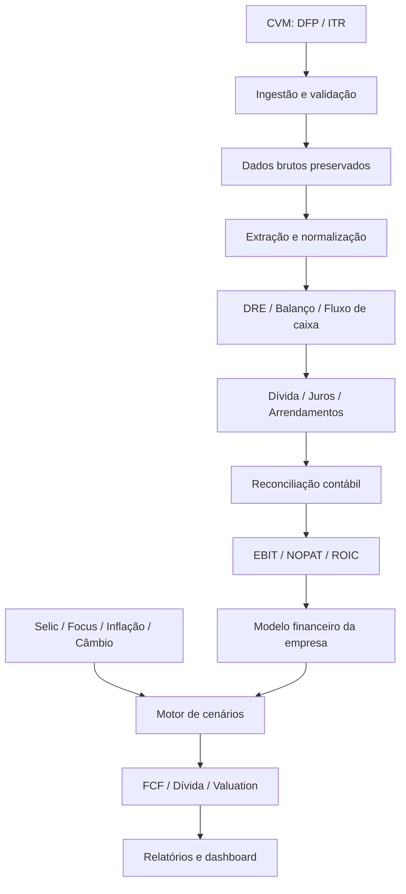

# SELIX — Arquitetura de Engenharia

## 1. Objetivo

Definir a arquitetura de evolução do SELIX para um pipeline reproduzível
de análise econômica, financeira e empresarial, utilizando dados oficiais,
métodos documentados e evidências rastreáveis.

A arquitetura integra:
- Ingestão de dados oficiais.
- Extração e normalização contábil.
- Reconciliação de dívida, juros, caixa e arrendamentos.
- Indicadores financeiros e retorno sobre capital.
- Séries macroeconômicas e expectativas.
- Cenários de juros, fluxo de caixa e valuation.
- Relatórios e evidências.

Este documento descreve o destino arquitetural. A presença de um caminho
nesta especificação não significa que o módulo já esteja implementado.

## 2. Princípios

1. Preservar os dados originais.
2. Não misturar observações oficiais com estimativas.
3. Identificar empresa, perímetro societário e exercício fiscal.
4. Preservar escala, unidade, versão e origem dos dados.
5. Não somar contas agregadoras com suas contas-filhas.
6. Separar dívida financeira de arrendamentos IFRS 16.
7. Rastrear cada indicador até seus dados de origem.
8. Não executar valuation com dados contábeis críticos não reconciliados.
9. Manter testes de regressão para cálculos financeiros.
10. Não alterar snapshots oficiais sem processo próprio de validação.

## 3. Estrutura de destino

```text
selix/
├── data/
│   ├── raw/
│   │   └── cvm/
│   │       ├── dfp/
│   │       └── itr/
│   ├── processed/
│   │   ├── cvm/
│   │   ├── financials/
│   │   ├── debt/
│   │   └── recovery/
│   └── scenarios/
│       ├── selic/
│       ├── macro/
│       └── companies/
├── evidencias/
│   ├── cvm/
│   ├── reconciliation/
│   ├── recovery/
│   └── sources/
├── src/selix/
│   ├── ingestion/
│   │   ├── cvm.py
│   │   └── validation.py
│   ├── recovery/
│   │   ├── cvm_extract.py
│   │   ├── debt.py
│   │   ├── leases.py
│   │   └── reconciliation.py
│   ├── financials/
│   │   ├── income.py
│   │   ├── balance.py
│   │   ├── cashflow.py
│   │   └── metrics.py
│   ├── valuation/
│   │   ├── returns.py
│   │   ├── invested_capital.py
│   │   ├── nopat.py
│   │   └── valuation.py
│   ├── macro/
│   │   ├── selic.py
│   │   ├── focus.py
│   │   ├── inflation.py
│   │   └── exchange.py
│   ├── scenarios/
│   │   ├── engine.py
│   │   ├── assumptions.py
│   │   └── sensitivity.py
│   ├── companies/
│   │   ├── gpa.py
│   │   ├── raizen.py
│   │   └── petrobras.py
│   └── reporting/
│       ├── dashboard.py
│       └── export.py
├── tests/
│   ├── ingestion/
│   ├── recovery/
│   ├── financials/
│   ├── valuation/
│   ├── macro/
│   └── scenarios/
├── docs/
├── scripts/
│   ├── inspect_cvm.py
│   ├── import_cvm.py
│   ├── reconcile_company.py
│   └── run_analysis.py
└── public/
```

## 4. Responsabilidades das camadas

### data/raw
Cópias imutáveis dos arquivos de origem. Não corrigir valores diretamente
nos arquivos originais. Registrar hashes e metadados de ingestão.

### data/processed
Dados normalizados e derivados. Cada conjunto deve identificar sua versão,
fonte, data de processamento e regras de transformação.

### evidencias
Documentos, extratos, hashes, relatórios de reconciliação e justificativas
para decisões de classificação contábil.

### src/selix/ingestion
Leitura, validação e identificação dos arquivos de origem.

### src/selix/recovery
Extração CVM, classificação de dívida, arrendamentos e reconciliação.

### src/selix/financials
DRE, balanço patrimonial, fluxo de caixa e indicadores normalizados.

### src/selix/valuation
NOPAT, capital investido, ROIC e valuation.

### src/selix/macro
Selic observada, expectativas Focus, inflação e câmbio.

### src/selix/scenarios
Premissas, motor de cenários e sensibilidades.

### src/selix/companies
Configurações específicas de empresas e perímetros societários.

### src/selix/reporting
Relatórios, exportações e visualizações.

## 5. Fluxo de dados



## 6. Contratos entre camadas

- Ingestão não calcula valuation.
- Extração não altera arquivos de origem.
- Reconciliação deve preservar divergências e justificativas.
- Indicadores devem carregar período, unidade e proveniência.
- Cenários devem distinguir dados observados, expectativas e premissas.
- Reporting não deve recalcular silenciosamente indicadores.
- Falhas de dados críticos devem bloquear a execução dependente.

## 7. Empresas e perímetros

O modelo inicial contempla:
- GPA: CD_CVM 014826.
- Raízen Energia: CD_CVM 023230, sem presumir equivalência com a holding
  Raízen S.A.
- Petrobras: CD_CVM 009512.

Cada empresa deve ter identificação legal, CNPJ, CD_CVM, tipo de demonstração
e perímetro de consolidação registrados.

## 8. Estado e evolução

A árvore é uma arquitetura de destino. Antes de criar módulos novos,
inspecionar a estrutura existente e reutilizar implementações válidas.

A implementação de recovery já existente deve ser preservada e evoluída
incrementalmente.
